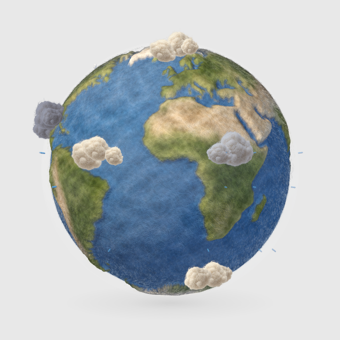
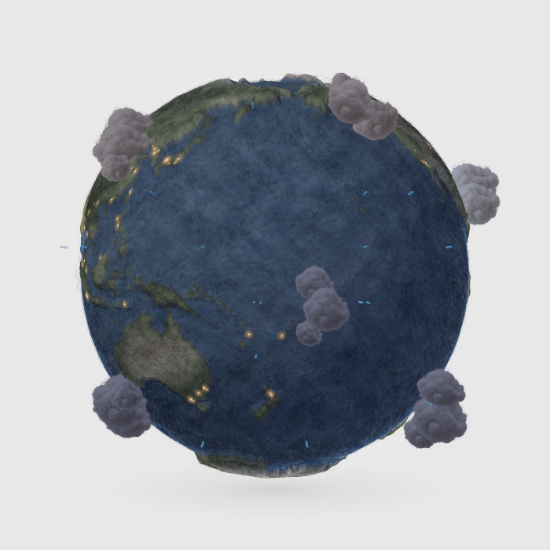

# Little Earth 🌍

A tiny felt globe that lives on your Mac desktop. Watch the world turn, see regional weather and city lights after dark, and click to discover a little more about a place.

[Download the free Mac beta](https://github.com/Venomn/little-earth/releases/tag/v0.8.4-beta.21) · [简体中文](#简体中文) · [Report a problem](https://github.com/Venomn/little-earth/issues)

**Apple Silicon (M-series) · macOS 14 or later · v0.8.4 beta, build 21**

| Day | Night |
| --- | --- |
|  |  |

Actual app renderer output, not concept art. Weather in these images is a recorded snapshot; your globe uses current regional model data.

## Install

1. Open the [beta release](https://github.com/Venomn/little-earth/releases/tag/v0.8.4-beta.21).
2. Under **Assets**, download **Little-Earth-0.8.4-beta-21-apple-silicon.zip**. The automatically generated **Source code** archives are not the app.
3. Double-click the ZIP to unpack it. Drag **Little Earth.app** into **Applications**.
4. Open Little Earth from Applications. Use its globe menu-bar icon or right-click the globe for settings and Quit.

The app is Developer ID signed, notarized by Apple and includes a stapled notarization ticket. You do not need Xcode, Terminal, an app account or an API key for the globe, weather and stories. Intel Macs are not supported in this beta.

## What it does

- **A gently rotating felt world.** A real 3D globe with raised continents, fine wool fibers and soft clouds, floating over your desktop. It turns about once every two minutes.
- **Weather across the globe at once.** Clouds, rain and snow follow their geographical regions as the globe turns. Open-Meteo supplies regional model weather at 186 sample locations, refreshed hourly. Click for the nearby weather details and data time.
- **Real day and night.** Sunlight follows the current time and the Earth's solar geometry. Warm city lights gradually appear on the night side; clouds become softer and darker after sunset.
- **Little cultural discoveries.** Click land to read a short, sourced story about local seasons, festivals or everyday traditions. The beta includes 23 curated stories across 13 countries, with seasonal selection based on local time. Unsupported places are clearly identified.
- **Ocean life.** Click a supported ocean region for a short fish and habitat introduction. Ten regional profiles cover representative waters across the five oceans, plus places such as the Mediterranean and Caribbean. Source links include NOAA and British Antarctic Survey.
- **Optional real ship positions.** Connect your own AISStream key to see felt sailboats anchored to received AIS coordinates and headings. Click a boat for its name, MMSI, speed, heading/course and report or reception time. Boats are intentionally sparse: up to 28 representative vessels, separated by at least 15°; old reports expire after 15 minutes.
- **Simple desktop controls.** Move, spin, pause, resize, hide, keep on top or bring the globe back to the current screen. No permanent toolbar under the globe.
- **English and Simplified Chinese.** English is the default; switching language updates menus, weather and reading cards and is remembered next time.

## Controls

| Action | Gesture |
| --- | --- |
| Move the globe | Drag it |
| Spin it manually | Hold **Option (⌥)** while dragging |
| Pause rotation and read about a place or ship | Click it |
| Close a card and resume rotation | Press **Esc** or click outside the card |
| Resize | Right-click → **Size** slider |
| Change language, weather or ship settings | Right-click, or use the menu-bar globe icon |
| Hide, keep on top, recover position or quit | Globe menu |

Size, position, language and display preferences are saved locally. Animation and network work pause when hidden, locked or asleep.

## Optional ship tracking

Open **Ship tracking…** from the globe menu. Obtain your own account/key at [AISStream](https://aisstream.io/account), then enter the key **only in the app** and select **Save and connect**. Keys are stored in macOS Keychain; no shared key is included. If macOS requests Keychain access after an update, use the app's saved-key reconnect action and respond in the system dialog. Remove a saved key from the same settings panel.

The helper runs locally as part of the app; no server setup or extra runtime installation is needed. AIS coverage depends on the upstream provider. A felt sailboat is an artistic symbol and does not identify the real vessel type. This is not a navigation tool.

## Data, privacy and beta limits

- Weather is **regional model data**, not satellite imagery or street-level live observations. There is no device-location permission request. Old or missing weather is marked or hidden rather than replaced with fictional weather.
- City lights use static city anchors and artistic glow, not live electricity data. Cultural stories and fish profiles are curated offline reading, not live event schedules or fish tracking.
- No analytics SDK, ads or developer-operated server are included. Weather requests go directly to Open-Meteo. Optional ship requests go directly to AISStream using your own key. Providers receive normal network connection information such as your IP address.
- This is a free personal/non-commercial beta. Provider availability, usage limits and [Open-Meteo terms](https://open-meteo.com/en/terms) apply. Free distribution is not a grant of commercial rights to an upstream service.
- There is no automatic updater. Quit the app before replacing it with a later release. Other Mac models, macOS versions and clean installations are still being tested.
- This repository provides beta downloads, documentation and issue tracking. It is not a source-code release.

See [Privacy](PRIVACY.txt) and [data/artwork attribution](THIRD_PARTY_NOTICES.md). Please report bugs in [Issues](https://github.com/Venomn/little-earth/issues), including Mac model, macOS version, app version and steps to reproduce. Do not include passwords, API keys or screenshots containing private information.

---

## 简体中文

**羊毛小地球**是一只悬浮在 Mac 桌面上的毛毡地球：缓缓自转、展示世界各地的区域天气，夜晚亮起暖色城市灯光。点击陆地、海洋或小船，还能展开简洁的信息卡片。

### 下载安装

支持 **Apple Silicon（M 系列）Mac、macOS 14 或以上**，本轮暂不支持 Intel。

1. 打开[免费测试版下载页](https://github.com/Venomn/little-earth/releases/tag/v0.8.4-beta.21)。
2. 在 **Assets** 下下载 **Little-Earth-0.8.4-beta-21-apple-silicon.zip**；不要下载 GitHub 自动生成的 **Source code**，那不是安装包。
3. 双击解压，把 **Little Earth.app** 拖入「应用程序」，再打开。
4. 右键地球或点击菜单栏地球图标进入设置；在 **Language → 简体中文** 切换语言。

安装包已通过 Developer ID 签名及 Apple 公证，不需要 Xcode、终端或应用账号。天气、文化与海洋科普无需 Key；只有可选的船只追踪需要自己的 AISStream Key。

### 完整功能

- **羊毛毡三维地球**：大陆起伏、细纤维和蓬松云团，约两分钟自转一圈。
- **全球天气同时呈现**：云、雨、雪跟随地理位置转动；186 个区域采样点，每小时更新，点击可读天气详情和数据时间。
- **真实昼夜与夜间灯光**：按当前时间计算日照，夜间城市暖灯渐亮、日出渐隐。
- **当地文化卡片**：23 条精选故事、13 个国家，介绍当地季节、节庆和生活习俗，并附资料来源。未收录地区会明确提示。
- **海洋鱼类科普**：10 条海域配置，介绍代表鱼类及栖息习性，附 NOAA 等来源；不是实时鱼群位置。
- **真实 AIS 船位**：自备 Key 后显示稀疏毛毡小帆船；点击可读船名、MMSI、航速、航向和时间。最多展示 28 艘代表船只，过期船位清除，覆盖由上游服务决定。
- **直觉交互**：普通拖动移动，Option + 拖动拨转，单击暂停并读卡片，Esc 或卡片外单击关闭并恢复自转。
- **桌面设置**：菜单内连续大小滑条、显示/隐藏、置顶、找回当前屏幕；桌面上没有拖拽横杠。设置本地保存，隐藏、锁屏和睡眠时暂停活动。
- **英语与简体中文**：默认英语，菜单、天气、故事与提示均可切换并记住选择。

天气来自 Open-Meteo 区域模型，不是卫星实况或精确城市预报；城市灯光为美术化表达，文化内容不是当天活动日程。应用不请求设备定位，不接入分析或广告 SDK。船只 Key 只保存在本机钥匙串，不要发到评论、Issue 或聊天里。

这是免费个人/非商业测试版，数据服务的条款、额度和可用性仍适用。暂无自动更新，升级前请先退出旧版。遇到问题请到 [Issues](https://github.com/Venomn/little-earth/issues) 附机型、系统版本、复现步骤及不含私人内容的截图。
